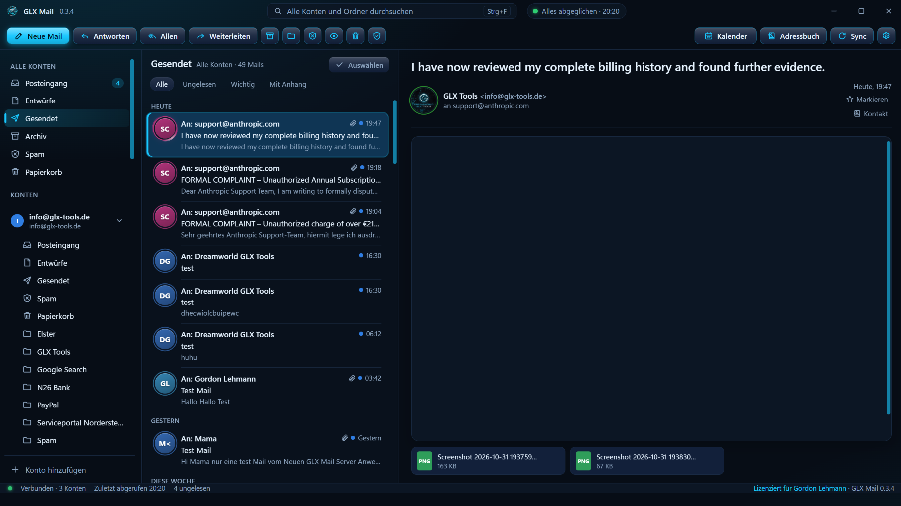
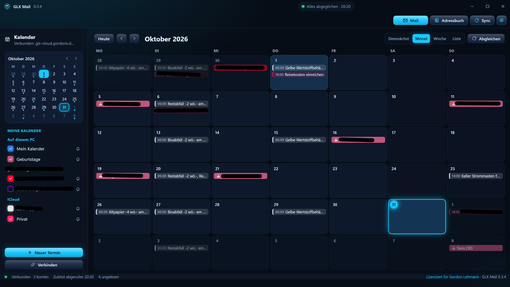

🌍 Sprachen: [🇺🇸 English](README.md) | [🇩🇪 Deutsch](README.de.md)

# 📬 GLX Mail für Windows

### Deine externen E-Mail-Konten gemeinsam in einem Windows-Programm ✉️

*Ein Windows-Mailprogramm mit integriertem Kalender und Adressbuch. Verbinde deine vorhandenen externen E-Mail-Konten – ohne eigenen Linux-Server und ohne eine GLX-Tools-E-Mail-Adresse zu benötigen.* ⚡

---

## ⬇️ GLX Mail für Windows herunterladen

👉 **[GLX Tools – Shopübersicht](https://glx-tools.de/shopuebersicht/)** — Produktinformationen, kostenlose Testversion und Lizenz.

Die Windows-Version kann **14 Tage kostenlos** getestet werden. Nach Ablauf der Testphase wird die Synchronisierung deaktiviert, bis eine Lizenz erworben wurde.

---

## 📸 Übersicht & Screenshots

### 1️⃣ Mail-Ansicht

  

### 2️⃣ Kalender-Ansicht

  

---

## ✨ Funktionen

- 📮 **Externe E-Mail-Konten:** Verbinde und verwalte deine vorhandenen E-Mail-Konten in einem einzigen Windows-Programm.
- 📨 **Zentrale Mail-Ansicht:** Bearbeite Nachrichten der verbundenen Konten an einem Ort.
- 👥 **Integriertes Adressbuch:** Deine Kontakte direkt zusammen mit deinen E-Mails verwalten.
- 📅 **Integrierter Kalender:** Termine und Kalenderinformationen direkt im Programm verwalten.
- 🖥️ **Windows-Desktopprogramm:** GLX Mail lokal installieren und verwenden – kein Linux-Server erforderlich.
- 🔓 **Keine GLX-Mail-Adresse nötig:** Du kannst die Windows-Version mit deinen vorhandenen externen E-Mail-Konten nutzen.

---

## 🧪 Testphase & Lizenz

- **14 Tage kostenlose Testphase** – teste das Programm vor dem Kauf.
- **Jahreslizenz: 24,90 € pro Jahr.**
- Nach Ablauf der Testphase wird die Synchronisierung deaktiviert, bis die Lizenz freigeschaltet ist.

Die Lizenz wird über den GLX Tools Shop erworben.

---

## 🚀 Installation

1. Öffne die **[GLX Tools Shopübersicht](https://glx-tools.de/shopuebersicht/)**.
2. Lade die Windows-Testversion herunter.
3. Installiere und starte GLX Mail für Windows.
4. Verbinde deine externen E-Mail-Konten und richte Adressbuch und Kalender ein.
5. Kaufe und aktiviere die Jahreslizenz vor oder nach Ablauf der Testphase.

---

## 🔗 Mehr zu diesem Produkt

👉 **[GLX Tools – Shopübersicht](https://glx-tools.de/shopuebersicht/)** — Produktbeschreibung, Testversion und Kauf.

Support: **info@glx-tools.de**

---

## 📄 Lizenz

GLX Mail für Windows ist kommerzielle Software von GLX Tools. Die geltenden Nutzungsrechte ergeben sich aus der über den GLX Tools Shop erworbenen Lizenz. Dieses Repository enthält Produktdokumentation und Screenshots.

---

Mit ❤️ erstellt von **Dreamdancer100**

