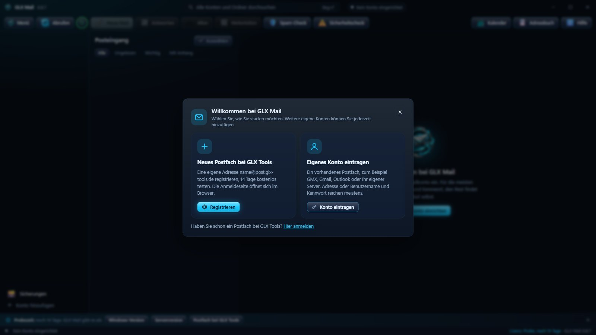
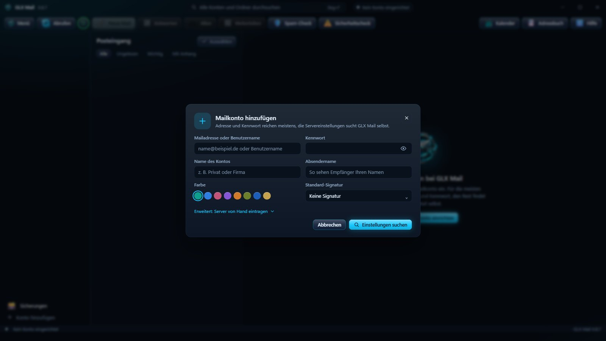
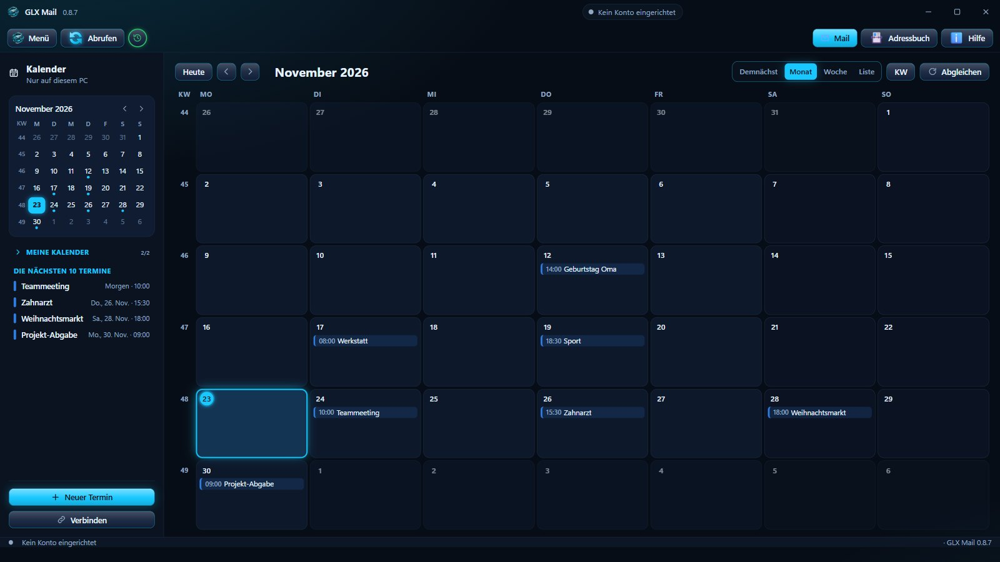
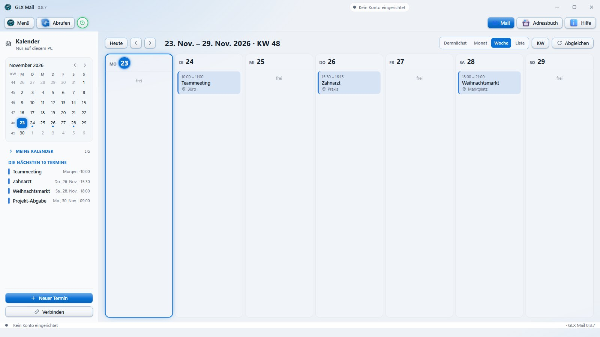
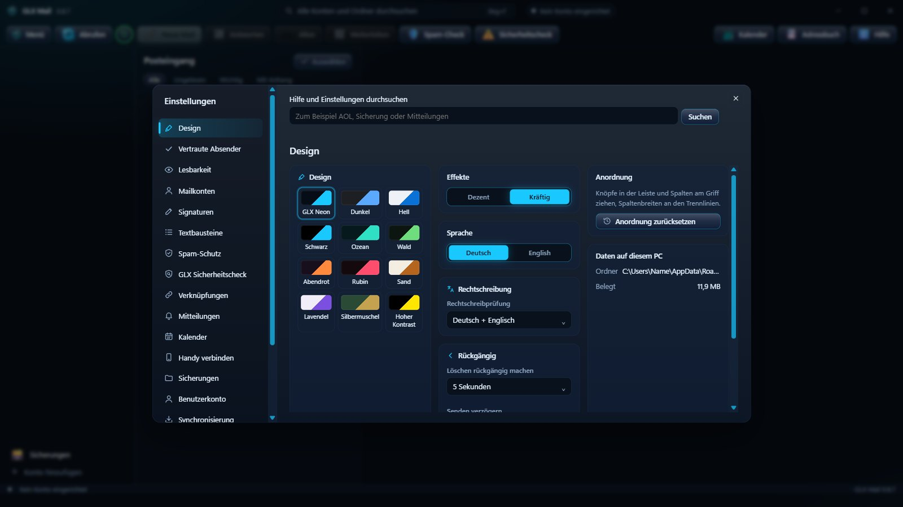

🌍 Sprachen: [🇺🇸 English](README.md) | [🇩🇪 Deutsch](README.de.md)

# 📬 GLX Mail für Windows

### Deine externen E-Mail-Konten gemeinsam in einem Windows-Programm ✉️

*Ein Windows-Mailprogramm mit integriertem Kalender und Adressbuch. Verbinde deine vorhandenen externen E-Mail-Konten – ohne eigenen Linux-Server und ohne eine GLX-Tools-E-Mail-Adresse zu benötigen.* ⚡

---

## ⬇️ GLX Mail für Windows herunterladen

👉 **[GLX Tools – Shopübersicht](https://glx-tools.de/shopuebersicht/)** — Produktinformationen, kostenlose Testversion und Lizenz.

Die Windows-Version kann **14 Tage kostenlos** getestet werden. Nach Ablauf der Testphase wird die Synchronisierung deaktiviert, bis eine Lizenz erworben wurde.

---

## 📖 Über GLX Mail für Windows

### Das E-Mail-Programm für deinen Windows-PC

GLX Mail holt deine Mails von allen Anbietern, sortiert sie übersichtlich und sichert sie automatisch. Du trägst beliebig viele Konten ein, etwa web.de, GMX, Gmail, Outlook, T-Online oder deinen eigenen Server per IMAP oder POP3. Die Servereinstellungen findet GLX Mail selbst.

### Übersichtlich und schnell

Drei Spalten für Ordner, Mails und Vorschau, Ziehen und Ablegen in Ordner, Schnell-Buttons an jeder Mail, Mehrfachauswahl und eine schnelle Suche über alle Ordner. Spam meldest du mit einem Klick: Der Absender landet in der gemeinsamen Sperrliste von GLX Mail Guard und GLX Spam Guard.

### Kalender und Adressbuch

Der eingebaute Kalender zeigt Monat, Woche und Liste, verbindet Nextcloud-, iCloud- und andere CalDAV-Kalender und erinnert dich wie Outlook, mit Geburtstagen aus deinem Adressbuch.

### Sichere Sicherungen

Automatische Sicherungen von stündlich bis monatlich behalten die letzten fünf Stände, einzelne Mails oder ganze Ordner holst du mit einem Klick zurück. Passwörter und Sicherungen werden verschlüsselt.

### Testen und Lizenz

12 Designs, Deutsch und Englisch. 14 Tage kostenlos testen, danach eine Monats- oder Jahreslizenz, jederzeit umstellbar. Kein Abo mit Haken, es wird nichts automatisch abgebucht.

---

## 📸 Überblick & Screenshots

### 1️⃣ Willkommen: GLX-Postfach anlegen oder eigenes Konto eintragen

### 2️⃣ E-Mail-Konto hinzufügen

### 3️⃣ Kalender-Monatsansicht

### 4️⃣ Kalender-Wochenansicht im hellen Design

### 5️⃣ Einstellungen: Designs und Sprache

---

## ✨ Funktionen

- 📮 **Externe E-Mail-Konten:** Verbinde und verwalte deine vorhandenen E-Mail-Konten in einem einzigen Windows-Programm.
- 📨 **Zentrale Mail-Ansicht:** Bearbeite Nachrichten der verbundenen Konten an einem Ort.
- 👥 **Integriertes Adressbuch:** Deine Kontakte direkt zusammen mit deinen E-Mails verwalten.
- 📅 **Integrierter Kalender:** Termine und Kalenderinformationen direkt im Programm verwalten.
- 🖥️ **Windows-Desktopprogramm:** GLX Mail lokal installieren und verwenden – kein Linux-Server erforderlich.
- 🔓 **Keine GLX-Mail-Adresse nötig:** Du kannst die Windows-Version mit deinen vorhandenen externen E-Mail-Konten nutzen.

---

## 🧪 Testphase & Lizenz

- **14 Tage kostenlose Testphase** – teste das Programm vor dem Kauf.
- **Jahreslizenz: 24,90 € pro Jahr.**
- Nach Ablauf der Testphase wird die Synchronisierung deaktiviert, bis die Lizenz freigeschaltet ist.

Die Lizenz wird über den GLX Tools Shop erworben.

---

## 🚀 Installation

1. Öffne die **[GLX Tools Shopübersicht](https://glx-tools.de/shopuebersicht/)**.
2. Lade die Windows-Testversion herunter.
3. Installiere und starte GLX Mail für Windows.
4. Verbinde deine externen E-Mail-Konten und richte Adressbuch und Kalender ein.
5. Kaufe und aktiviere die Jahreslizenz vor oder nach Ablauf der Testphase.

---

## 🔗 Mehr zu diesem Produkt

👉 **[GLX Tools – Shopübersicht](https://glx-tools.de/shopuebersicht/)** — Produktbeschreibung, Testversion und Kauf.

Support: **info@glx-tools.de**

---

## 📄 License

Copyright © 2026 GLX Tools – Gordon Lehmann.
All rights reserved.

GLX Mail is proprietary commercial software.
No open-source license is granted.

The software may only be used under the
applicable license purchased through GLX Tools.

This repository contains product documentation
and screenshots. All rights to these materials
are reserved by their respective copyright holders.

GLX Mail Postfach is a hosted commercial service from GLX Tools. The applicable usage rights are defined by the license purchased through the GLX Tools shop. This repository provides product documentation and screenshots.

---

Mit ❤️ erstellt von **Dreamdancer100**

