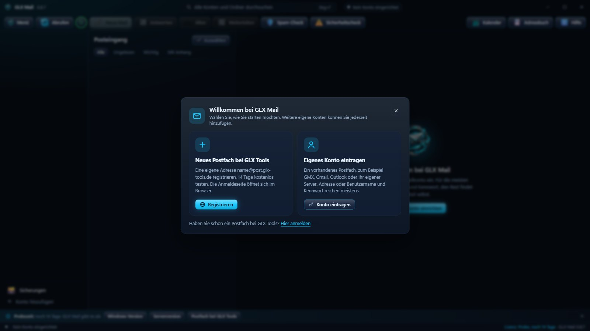
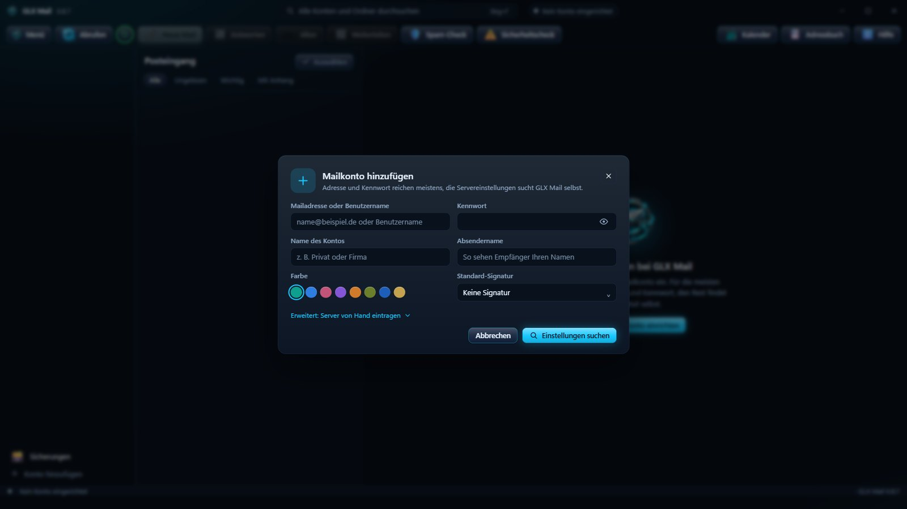
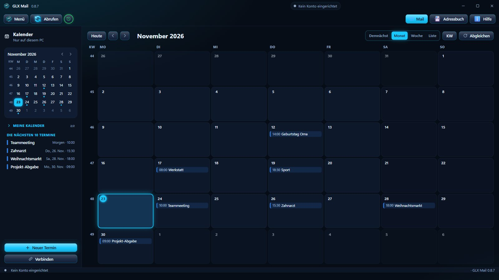
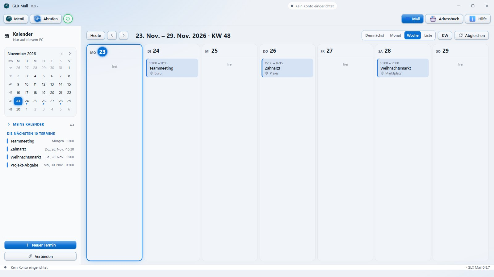
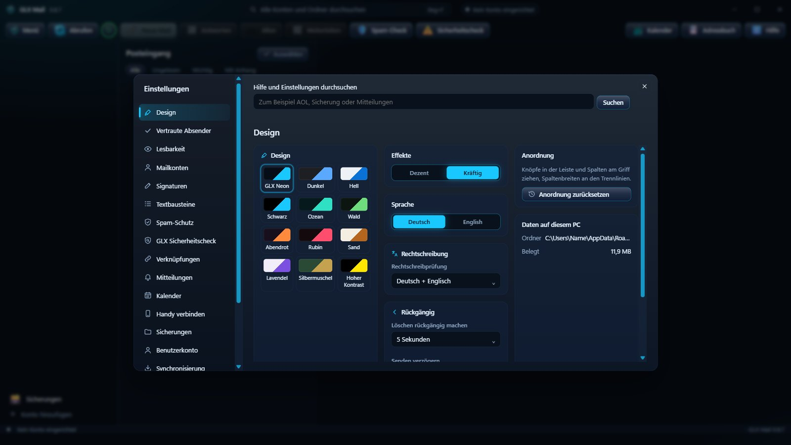

🌍 Languages: [🇺🇸 English](README.md) | [🇩🇪 Deutsch](README.de.md)

# 📬 GLX Mail for Windows

### Your external email accounts, together in one Windows application ✉️

*A Windows desktop mail client with an integrated calendar and address book. Connect your existing external email accounts — without running your own Linux server and without needing a GLX Tools email address.* ⚡

---

## ⬇️ Get GLX Mail for Windows

👉 **[GLX Tools Shop – product overview](https://glx-tools.de/shopuebersicht/)** — product information, free trial and license.

The Windows version can be tested free of charge for **14 days**. After the trial period, synchronization is disabled until a license is purchased.

---

## 📖 About GLX Mail for Windows

### The email program for your Windows PC

GLX Mail collects mail from all your providers, sorts it clearly and backs it up automatically. Add any number of accounts such as web.de, GMX, Gmail, Outlook, T-Online or your own server with IMAP or POP3; the server settings are found automatically.

### Clear and fast

Three columns for folders, mails and preview, drag and drop into folders, quick buttons at every mail, multiple selection and a fast search across all folders. Report spam with one click: the sender lands in the shared block list of GLX Mail Guard and GLX Spam Guard.

### Calendar and address book

The built-in calendar shows month, week and list, connects Nextcloud, iCloud and other CalDAV calendars and reminds you like Outlook, with birthdays from your address book.

### Safe backups

Automatic backups from hourly to monthly keep the last five versions, and single mails or whole folders come back with one click. Passwords and backups are encrypted.

### Try and licence

12 designs, German and English. Free for 14 days, then a monthly or yearly licence, switchable at any time. No subscription trap, nothing is charged automatically.

---

## 📸 Overview & Screenshots

### 1️⃣ Welcome: create a GLX mailbox or add your own account

### 2️⃣ Adding an email account

### 3️⃣ Calendar month view

### 4️⃣ Calendar week view in a light design

### 5️⃣ Settings: designs and languages

---

## ✨ Features

- 📮 **External email accounts:** Connect and manage your existing email accounts in one Windows application.
- 📨 **Central mail view:** Work with your messages from the connected accounts in one place.
- 👥 **Integrated address book:** Keep your contacts available alongside your email.
- 📅 **Integrated calendar:** Manage appointments and calendar information directly in the application.
- 🖥️ **Windows desktop application:** Install and use GLX Mail locally — no Linux server required.
- 🔓 **No GLX mailbox required:** You can use the Windows version with your existing external email accounts.

---

## 🧪 Trial & License

- **14-day free trial** — try the application before purchasing.
- **Annual license: €24.90 per year.**
- After the trial expires, synchronization is disabled until the license is activated.

The license is purchased through the GLX Tools shop.

---

## 🚀 Installation

1. Open the **[GLX Tools shop overview](https://glx-tools.de/shopuebersicht/)**.
2. Download the Windows trial version.
3. Install and start GLX Mail for Windows.
4. Connect your external email accounts and set up your contacts and calendar.
5. Purchase and activate the annual license before or after the trial period, as needed.

---

## 🔗 More about this product

👉 **[GLX Tools – Shop overview](https://glx-tools.de/shopuebersicht/)** — product details, trial and purchase.

For support: **info@glx-tools.de**

---

## 📄 License

Copyright © 2026 GLX Tools – Gordon Lehmann.
All rights reserved.

GLX Mail is proprietary commercial software.
No open-source license is granted.

The software may only be used under the
applicable license purchased through GLX Tools.

This repository contains product documentation
and screenshots. All rights to these materials
are reserved by their respective copyright holders.

GLX Mail Postfach is a hosted commercial service from GLX Tools. The applicable usage rights are defined by the license purchased through the GLX Tools shop. This repository provides product documentation and screenshots.

---

Made with ❤️ by **Dreamdancer100**

